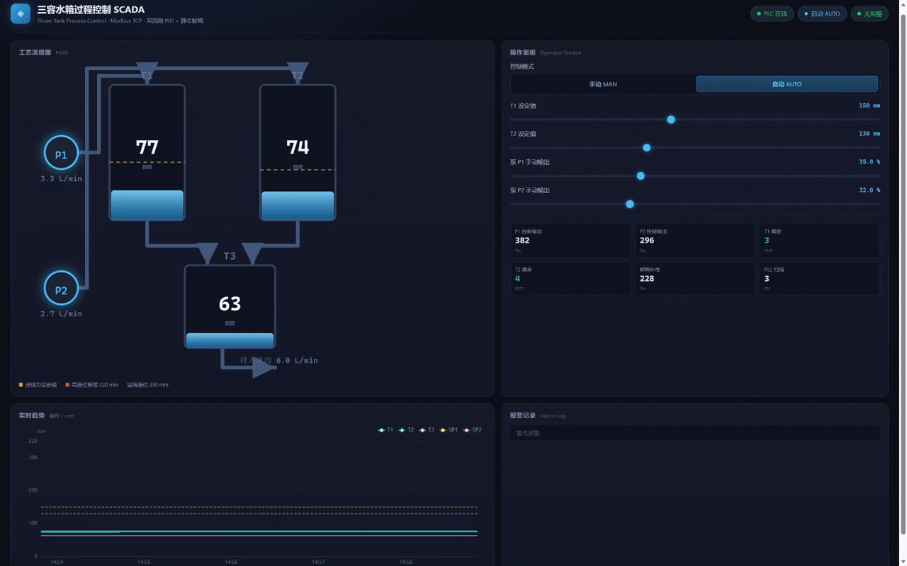

# 三容水箱过程控制 SCADA 系统

> 一个可完整运行的工业控制系统教学/演示项目：**现场对象仿真 → 软 PLC → Web SCADA** 三层架构，
> 通过真实的 **Modbus TCP** 协议通信，重点解决双回路液位控制中的**交叉耦合**问题。

控制算法、通讯协议、上位机界面三者解耦，每个进程都可以独立启动、独立观测，
与真实工业现场的层次划分一致。



<sub>如果动图无法正常加载，可以[直接打开原始动图](https://raw.githubusercontent.com/WviWei/three-tank-scada/main/docs/demo-system.gif)。</sub>

---

## 一、要解决的问题

三容水箱是过程控制里经典的多变量耦合对象：

```
        泵1 ──► T1 ──┐  q13 = c13·√(h1-h3)
                      ├──► T3 ──► 排入地沟   q3 = c3·√h3
        泵2 ──► T2 ──┘  q23 = c23·√(h2-h3)
```

T3 是两个回路的**公共下游**。当 T1 回路加大泵1 提高 h1 时，h3 随之抬高，
T2 的下泄压差 (h2−h3) 被压缩，于是 h2 被动上升 —— 这就是耦合的物理来源。

在闭环中，这种耦合表现为：**单独整定好一个回路后，另一个回路的动作会破坏它**，
最终两个回路互相拉扯，收敛极慢。

### 定量描述：相对增益阵 (RGA)

对工作点做开环阶跃辨识，得到稳态增益矩阵（单位 mm/permille）：

|        | 泵1 输入 | 泵2 输入 |
|--------|---------:|---------:|
| **h1** | 0.4270   | 0.2938   |
| **h2** | 0.2938   | 0.4159   |

据此计算 RGA 对角元 **λ₁₁ = 1.945**，耦合度 `|g12·g21| / |g11·g22| = 0.486`。

λ 明显偏离 1，说明耦合不可忽略；但 λ 为正且对角元最大，说明
**泵1→T1、泵2→T2 的配对方向是正确的**，只是需要额外的解耦补偿。

> 数据由 `python tools/identify.py` 复现，输出见 `docs/identification.json`。

---

## 二、解决方案

采用**静态解耦器** `u = D·v`，其中 `D = [[1, -k12], [-k21, 1]]`，
使 `G·D` 成为对角阵，从而让两个 PID 回路可以独立整定：

```
理论值: k12 = -g12/g11 ≈ 0.688,  k21 = -g21/g22 ≈ 0.706
实际取: k12 = 0.40,            k21 = 0.45   (0.6 倍部分解耦)
```

**为什么不用全解耦？** 全解耦在设定值大阶跃时会把执行器推入饱和
（解耦本身要消耗额外控制能量），反而恶化动态品质。取 0.6 倍是在
「抑制耦合」与「保留调节余量」之间的折中，这一点在实机上反复验证过。

另外两个工程细节：

- **无扰切换 (Bumpless Transfer)**：MAN→AUTO 时用当前手动输出反算积分项，输出原地保持，不产生跳变；
- **设定值斜坡**：AUTO 投入时设定值从当前实际液位开始爬坡（4 mm/s），避免大偏差下一次冲到饱和。

---

## 三、实验结果

同一套对象模型、同一组 PID 参数，只切换解耦开关，给 T1 设定值一个
**150 → 175 mm** 的阶跃，T2 设定值保持 130 mm：

| 指标 | 解耦 ON | 解耦 OFF | 说明 |
|------|--------:|---------:|------|
| T1 调节时间 (s) | **37.0** | 112.0 | ±2% 误差带，**改善 67%** |
| T2 受扰峰值 (mm) | **3.0** | 4.9 | 阶跃期间 T2 被带偏的最大值，**降低 38.8%** |
| T1 超调量 (%) | 4.0 | 0.0 | 解耦后响应快 3 倍，代价是 4% 超调 |
| T1 稳态误差 (mm) | 0 | 0 | |
| T2 稳态误差 (mm) | 0 | 0 | |

结论：解耦的收益主要体现在**收敛速度**和**回路间干扰**上；
关掉解耦时系统虽然最终也能稳定，但调节时间延长到 3 倍，
且 T2 在整个过渡过程中被明显带偏 —— 这正是现场"两个回路互相打架"的定量再现。

> 由 `python tools/identify.py` 离线仿真复现（几秒完成）；
> 真实 Modbus 链路上的复核见 `python tools/step_test.py`。

---

## 四、系统架构

```
┌──────────────────────────────────────────────────────┐
│  浏览器   ECharts 实时趋势 · SVG 工艺流程图 · 报警    │
└───────────────────────┬──────────────────────────────┘
                        │ WebSocket 10 Hz / REST
┌───────────────────────▼──────────────────────────────┐
│  SCADA 上位机      scada/main.py                     │
│  FastAPI · 采集 100 ms · SQLite 历史 · 指令下发       │
└───────────────────────┬──────────────────────────────┘
                        │ Modbus TCP Client（读 PV / 状态）
┌───────────────────────▼──────────────────────────────┐
│  软 PLC            controller/plc.py                 │
│  扫描 100 ms · PI · 静态解耦 · 报警 · 无扰切换        │
└───────────────────────┬──────────────────────────────┘
                        │ Modbus TCP Client（读 PV，写 MV）
┌───────────────────────▼──────────────────────────────┐
│  现场对象          plant/plant.py   :5020 从站        │
│  三容水箱微分方程 · 仿真步长 50 ms · 5 ms 子步        │
└──────────────────────────────────────────────────────┘
```

职责边界是刻意划分的：**对象不含控制、PLC 不含界面、SCADA 不含控制算法**。

---

## 五、快速开始

### 本地运行（无需 Docker）

```bash
pip install -r requirements.txt
python run.py
```

打开 <http://127.0.0.1:8000>。默认处于**手动工况**（泵1 50%、泵2 45%），
在操作面板上切到 **AUTO** 即可观察闭环调节过程。

```bash
python run.py --no-plc   # 只起对象和上位机，纯手动调试
```

### Docker Compose

```bash
docker compose up --build
```

### 运行测试

```bash
python tools/smoke_plant.py    # 对象 + Modbus 从站
python tools/smoke_loop.py     # 对象 + PLC 闭环（约 100 s）
python tools/smoke_scada.py    # 端到端全链路（约 70 s）
python tools/identify.py       # 辨识 + 解耦对比（离线仿真，数秒）
```

---

## 六、寄存器映射

现场对象作为 Modbus TCP 从站（端口 5020），三方共用 `common/registers.py` 中的契约。

**Input Register（FC04，只读）**

| 地址 | 名称 | 单位 | 说明 |
|------|------|------|------|
| 0 | h1_mm | mm | T1 液位 |
| 1 | h2_mm | mm | T2 液位 |
| 2 | h3_mm | mm | T3 液位 |
| 3-7 | q1/q2/q13/q23/q3 | L/min ×100 | 各段流量 |
| 8 | overflow | bitmask | 溢流标志 |
| 9 | sim_time_s | s | 仿真运行时间 |

**Holding Register（FC03/06/16，读写）**

| 地址 | 名称 | 写入方 | 说明 |
|------|------|--------|------|
| 0-1 | pump1/2_permille | SCADA / PLC | 泵指令，0-1000 |
| 2 | plc_mode | SCADA | 0=MAN，1=AUTO |
| 3-4 | sp1/sp2_mm | SCADA | 液位设定值 |
| 6 | plc_heartbeat | PLC | 心跳，SCADA 据此判断 PLC 存活 |
| 7 | plc_alarm_word | PLC | 报警字 |
| 8-13 | PID 输出 / 偏差 / 解耦量 / 扫描周期 | PLC | 状态回读 |

所有浮点量按定点缩放传输（液位 ×1000 取 mm，流量 ×6e6 取 L/min×100）。

---

## 七、目录结构

```
tank-scada/
├── common/registers.py     # 三方共享的寄存器契约与工程量换算
├── plant/plant.py          # 被控对象仿真 + Modbus 从站
├── controller/plc.py       # 软 PLC：PI + 静态解耦 + 报警
├── scada/
│   ├── main.py             # FastAPI + WebSocket + SQLite
│   └── static/             # 前端（零构建，CDN 引 ECharts）
├── tools/                  # 冒烟测试 / 辨识 / 阶跃实验
├── docs/                   # 实验数据
├── run.py                  # 一键启动
├── Dockerfile
└── docker-compose.yml
```

---

## 八、实现要点

**被控对象**：显式欧拉积分，50 ms 主步长拆成 10 个 5 ms 子步；
泵与管路用一阶滞后（τ=0.8 s）模拟执行器动态；液位限幅并置溢流位。

**软 PLC**：位置式 PI，带积分抗饱和（clamping）与无扰切换；
设定值斜坡抑制大偏差超调；通讯异常连续 3 次则断开重连，故障自恢复。

**SCADA**：100 ms 采集，WebSocket 全量推送最新快照；
SQLite WAL 模式，1 Hz 采样入库；报警按上升沿去重后落库。

**前端**：零构建，静态 HTML + JS；ECharts 已本地化为
`scada/static/vendor/echarts.min.js`，**完全离线可用**，不依赖任何 CDN。

---

## 九、已知限制

- 对象参数是标称值，未考虑液位-流量特性的强非线性，解耦系数在偏离工作点时收益会下降；
- 静态解耦只补偿稳态增益，动态过程中仍存在相位差，因此采用部分解耦；
- 未实现 OPC UA 与冗余通讯，这两项属于后续扩展方向。

---

## License

MIT
